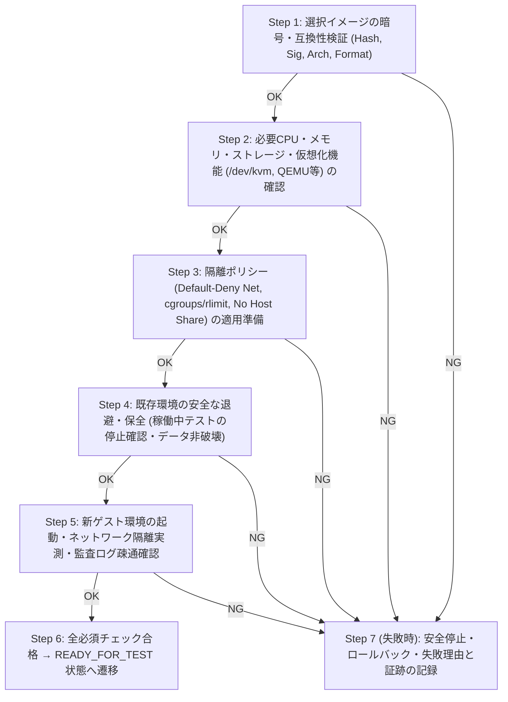

# MULTI_OS_VIRTUALIZATION.md — マルチOS仮想化・ゲストOS切り替え設計書

> **ステータス**: Phase 1（設計完了 / 実装未着手・承認待ち）

---

## 1. 実装済み・未実装・推定・未検証の区分

| 区分 | 内容 |
| :--- | :--- |
| **1. 証拠によって確認済み（実装済み）** | ホストCPUは Intel N100 (`VT-x` 対応)、`/dev/kvm` が存在し、現在のユーザー `harukiy1225` は `kvm` グループ (`gid=993`) に所属している。また `MK1Ai-main` には `mk1_usb_guard.py`（QEMUコマンドライン構築・検証）および `mk1-sandbox-os.sh`（Linux Namespace 分離）が存在する。 |
| **2. 静的解析による候補（未実装）** | AegisLab におけるマルチOSカタログ管理、OS切り替え時の7段階プリフライト検証、OS別テスト結果分離記録は**未実装**である。 |
| **3. 推定または設計上の懸念** | `/dev/kvm` は存在するが、ホストに `qemu-system-x86_64` や `firecracker` バイナリがインストールされておらず、かつ空きRAM約565MiB・空きディスク1.4GiBのため、WindowsゲストOSや大型標準Linux VMを現ホスト上で直接起動することはリソース的に不可能である。 |
| **4. 未検証** | 現ホスト上での実VM起動、WindowsゲストOSイメージの起動、およびカスタムOSイメージのブートは**未検証**である。 |

---

## 2. 選択可能なゲストOSカテゴリと表示ポリシー

「実際に対応できるイメージのみを選択肢としてアクティブ表示し、未構築・未導入のものは理由とともに非アクティブ（選択不可または要構築）として明示する」設計とする。

| OSカテゴリ | デフォルト設定 | 検証要件・ライセンス/互換性チェック | 現ホスト（空きRAM 565MiB / 空きDisk 1.4GiB）での扱い |
| :--- | :--- | :--- | :--- |
| **1. MK1Ai Secure Linux** | **デフォルト選択** | `manifest.json` + `manifest.sig` + `sbom.spdx.json` の暗号検証必須 | 初期表示は `未構築 (Not Built)`。承認後にビルド・検証完了で有効化。 |
| **2. 対応する標準Linux** (Debian 13 Minimal / Alpine LTS 等) | オプション | SHA-256固定ダイジェスト検証、アーキテクチャ (`x86_64`) 一致、最小RAM (`>=256MB`)・Disk確認 | ホスト共有Read-Only Namespace方式（Debian 13 ベース）は利用可能候補。フルVMイメージは要ハイパーバイザ＆空き容量確保。 |
| **3. WindowsゲストOS** | オプション | ユーザーが正規ライセンスキー/証跡および署名・ハッシュ確認済みイメージを提供した場合のみ登録可。KVM + `qemu-system-x86_64` + 最低 2〜4 GiB 空きRAM + 20 GiB 空きDisk が必須。 | 現ホストではリソース要件（RAM/Disk/QEMU）未達のため **`環境制約により実行不可 (Hardware/Resource Insufficient)`** として安全にブロックし、偽装起動しない。 |
| **4. 検証済みカスタムOSイメージ** | オプション | 形式 (`cpio.gz` / `qcow2` / `raw`)、バージョン、アーキテクチャ、SHA-256、OpenSSL署名、必要CPU/RAM/Disk、カーネル互換性の全項目チェック | すべての検証に合格し、かつホストの安全リソース上限内の場合のみ有効化。 |

---

## 3. OS切り替え時の厳格な7ステップ手順（State Machine）

ユーザーが仮想環境のゲストOSを切り替える際、バックエンドの `Multi-OS Virtualization Manager`（Module 3）は以下の7ステップを順番に実行し、**1つでも失敗した場合は即座に安全側へ停止（Fail-Closed）し、既存環境を破壊せずエラー理由を記録する**。



### 各ステップの検証項目詳細
1. **Step 1（イメージ検証）**: `manifest.json` のハッシュ一致、`manifest.sig` の公開鍵検証、シンボリックリンク不在、フォーマットヘッダー（ELF/bzImage, gzip/cpio, qcow2 magic）を確認。
2. **Step 2（リソース・機能確認）**: 要求メモリ $\le (\text{ホスト利用可能メモリ} - 300\text{ MiB})$、要求ディスク $\le (\text{ホスト空き容量} - 500\text{ MiB})$、必要な実行バックエンド（QEMUバイナリまたはNamespace権限）の存在を確認。
3. **Step 3（隔離ポリシー適用）**: 専用ネットワーク名前空間または `-nic none` / 内部隔離 `veth`、ホストファイルシステム非共有、プロセス上限・メモリ上限を設定。
4. **Step 4（非破壊準備）**: 既存のテスト結果データや既存環境の設定ファイルを上書きせず、新しい環境ID (`env_instance_uuid`) の独立ワークスペースを割り当てる。
5. **Step 5（起動・隔離・ログ確認）**: ゲスト起動後、(a) 外部IP（例: ホストゲートウェイ）への到達不能性、(b) 監査ログストリームの正常受信、(c) ゲストOS識別子の応答を確認。
6. **Step 6（テスト可能化）**: 1〜5すべてが `PASS` した場合のみステータスを `準備完了 (READY)` に遷移。
7. **Step 7（失敗時の安全停止）**: 起動途中のプロセスがあれば確実に終了させ、残存プロセスゼロを確認した上で `失敗 (FAILED)` または `未検証 (NOT TESTED)` として記録。

---

## 4. OS別テスト結果の完全分離スキーマ

異なるOSや異なるイメージバージョンでのテスト結果が統計やレポート上で混在しないよう、すべてのテレメトリ・証拠レコードのプライマリメタデータに以下を必須フィールドとして付与する。

```json
{
  "environment_context": {
    "env_instance_id": "env-20261029-0001",
    "guest_os_family": "mk1ai-secure-linux",
    "guest_os_version": "1.0.0-spec01",
    "image_manifest_sha256": "e3b0c44298fc1c149afbf4c8996fb92427ae41e4649b934ca495991b7852b855",
    "signature_verified": true,
    "virtualization_backend": "kvm-qemu | linux-ns-isolation | synthetic-dryrun",
    "host_kernel": "6.6.147-09648-g97ef00d8a343"
  }
}
```
