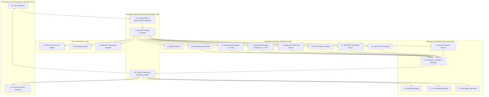

# SYSTEM_ARCHITECTURE.md — Project AegisLab × MK1Ai システム全体アーキテクチャ設計書

> **ステータス**: Phase 1（読み取り専用監査・基本設計完了 / 実装未着手・承認待ち）  
> **対象ワークスペース**: `/home/harukiy1225/テストツール`（新規・空ディレクトリ）  
> **参照既存資産**: `/home/harukiy1225/MK1Ai-main`（読み取り専用で監査済み・変更なし）

---

## 1. 実装状態の4区分サマリー

| 区分 | 内容 |
| :--- | :--- |
| **1. 証拠によって確認済み（実装済み）** | `/home/harukiy1225/MK1Ai-main` 内に、`airgap_ai_defender.py`（DPI・3-Head AI・キルスイッチ）、`mk1_airgap.py`、`mk1_firewall.py`、`mk1_usb_guard.py`（署名済みゲスト検証・使い捨てQEMU起動ロジック）、`security/usb-scan-guest/{Dockerfile,build.sh,sign.sh,usb-scan-init}`、`mk1-sandbox-os.sh`（Linux Namespace 分離）、`mk1_remote_dashboard.py`、`mk1_panel.c`、`scripts/verify_1m_packets_airgap.py`、`scripts/verify_1_6tbps_zero_trust.py` が存在する。 |
| **2. 静的解析による候補（未実装・流用可能）** | `/home/harukiy1225/テストツール` は現在空（0ファイル）であり、AegisLab の統合21モジュールは**すべて未実装**である。ただし `MK1Ai-main` の署名検証 (`sign.sh` / `mk1_usb_guard.py`) や Namespace サンドボックス (`mk1-sandbox-os.sh`)、DPIパイプライン (`airgap_ai_defender.py`) を読み取り専用アダプタ経由で連携可能。 |
| **3. 推定または設計上の懸念** | 現ホスト（Debian 13 / Crostini / Intel N100 4vCPU / RAM 2.6GiB・空き約565MiB / ディスク空き1.4GiB）では、複数フルVMの同時起動や大容量OSイメージの保持はリソース枯渇（OOM / ENOSPC）を引き起こす。 |
| **4. 未検証** | 現環境には `qemu-system-x86_64`、`firecracker`、`docker`、`clang`、`bpftool`、`nft`、`ffmpeg` が未インストールであり、`/sys/fs/bpf` への非特権アクセスも不可のため、実VM起動・実XDPカーネルアタッチ・実RTMP配信は**未検証**である。 |

---

## 2. 全21モジュールの責任範囲・入出力・API・信頼境界・停止条件

セキュリティ制御はUI（フロントエンド）だけに依存させず、すべてのAPI呼び出しおよび内部IPCにおいてバックエンド側の `Isolation & Safety Controller`（Module 4）および `Configuration & Feature Switch Manager`（Module 21）が強制検証（Fail-Closed）を行う。

### Module 1: MK1Ai Secure Linux Builder
- **責任範囲**: デフォルト専用ゲストOS「MK1Ai Secure Linux」の再現可能なビルド仕様管理、最小構成パッケージ定義、カーネル設定検証、SBOM（SPDX/CycloneDX JSON）・ビルドマニフェスト (`manifest.json`)・OpenSSL Ed25519/RSA署名 (`manifest.sig`) の生成。
- **入力**: ベースイメージダイジェスト (`@sha256:...`)、固定リポジトリURL、ビルド設定JSON、オフライン署名鍵パス。
- **出力**: `vmlinuz`, `initramfs.cpio.gz`（または `rootfs.squashfs`）、`manifest.json`, `manifest.sig`, `sbom.spdx.json`, `build-provenance.json`。
- **内部インターフェース**: `BuildSpecValidator.validate(spec) -> ValidationResult`, `SecureImageBuilder.plan_build(spec) -> BuildPlan`, `SecureImageBuilder.execute_build(spec, approval_token) -> BuildArtifact`。
- **権限・信頼境界**: ビルドはネットワーク遮断 (`--network none` または隔離名前空間) で実行。未承認時は `plan_build`（ドライラン）のみ許可。
- **エラー処理・停止条件**: ダイジェスト不一致、シンボリックリンク混入、ディスク空き容量不足（閾値 `< 1.0 GiB`）、署名失敗時は即時中断し一時ディレクトリを破棄。
- **テスト方法・監査証拠**: 同一入力からの2回ビルドによるSHA-256一致確認、SBOMスキーマ検証、ビルド監査ログ出力。
- **依存関係**: Module 2, Module 19, Module 21。

### Module 2: OS Image Manager
- **責任範囲**: 登録済みOSイメージ（MK1Ai Secure Linux、標準Linux、ライセンス検証済みWindowsゲスト、カスタムOS）のカタログ管理、ハッシュ・署名検証、互換性・必要リソース判定、安全なロールバック。
- **入力**: イメージファイル群、公開鍵 (`/etc/mk1ai/*.pub` 相当)、OSメタデータJSON。
- **出力**: 検証済みイメージ記述子 (`VerifiedImageDescriptor`：状態 `VERIFIED` / `UNVERIFIED` / `REJECTED`)。
- **内部インターフェース**: `ImageManager.verify_image(image_id) -> VerificationReport`, `ImageManager.select_os(env_id, image_id) -> SwitchPlan`。
- **権限・信頼境界**: イメージ格納領域は読み取り専用 (`0444`)、ディレクトリは `root` または専用ユーザー所有でシンボリックリンク禁止。未検証イメージは `TRUSTED` 昇格不可。
- **エラー処理・停止条件**: ハッシュ不一致、署名無効、アーキテクチャ不適合、ホスト空きメモリ/ストレージ不足時はOS切り替えを拒否し既存環境を維持。
- **テスト方法・監査証拠**: 改ざんマニフェスト・期限切れ鍵・破損イメージの拒否テスト。
- **依存関係**: Module 1, Module 3, Module 4, Module 19。

### Module 3: Multi-OS Virtualization Manager
- **責任範囲**: 仮想環境ごとのゲストOSライフサイクル管理（準備・起動・一時停止・停止・破棄・スナップショットロールバック）。環境能力に応じ、(A) KVM/QEMU microVM、(B) Linux Namespace 軽量サンドボックス (`mk1-sandbox-os.sh` 方式)、(C) 合成ドライラン実行器を切り替える。
- **入力**: `VerifiedImageDescriptor`、リソース上限設定 (`vcpu`, `mem_mb`, `disk_mb`, `timeout_sec`)、ネットワーク隔離ポリシー。
- **出力**: `GuestInstanceState`（起動状態、PID/VMID、隔離インターフェース名、コンソールログFD）。
- **内部インターフェース**: `VirtManager.prepare(env_spec) -> EnvHandle`, `VirtManager.start(handle, approval_token)`, `VirtManager.stop_and_verify(handle) -> StopProof`。
- **権限・信頼境界**: ホストとゲスト間の共有フォルダは原則禁止（結果取得はサイズ上限付きシリアル出力または読み取り専用マウントのみ）。
- **エラー処理・停止条件**: ハイパーバイザ不在（現環境は `qemu-system-x86_64` 未導入）、KVM権限不足、起動タイムアウト時は実VM起動を開始せず安全停止し、`NOT TESTED` / ドライランへフォールバック。
- **テスト方法・監査証拠**: ゲストプロセス完全消滅確認 (`kill -0` / cgroup / PID namespace 空確認)、OSバージョン証跡記録。
- **依存関係**: Module 2, Module 4, Module 13, Module 19。

### Module 4: Isolation & Safety Controller
- **責任範囲**: 常時有効（初期OFFスイッチで無効化不可）の強制安全制御。未信頼コードのホスト直接実行禁止、外部通信遮断（デフォルトAir-Gap）、cgroups/rlimitによるCPU・メモリ・プロセス数・ログ量制限、緊急停止（キルスイッチ）と停止完了確認。
- **入力**: 実行要求コンテキスト、リアルタイムリソース指標、境界違反イベント。
- **出力**: 実行許可トークン (`SafetyClearance`) または 強制停止命令 (`EmergencyHaltReceipt`)。
- **内部インターフェース**: `SafetyController.enforce_mandatory_policy(ctx)`, `SafetyController.trigger_emergency_halt(reason) -> HaltVerification`。
- **権限・信頼境界**: 最高優先度のガードモジュール。UIをバイパスした直接API呼び出しもすべて本モジュールを通過する。
- **エラー処理・停止条件**: 隔離違反、許可外IPへのソケット生成試行、RAM上限超過、ログ書き込み失敗時は即座にゲスト/ワーカーをSIGKILLし、残存プロセスゼロを確認するまで隔離を解除しない。
- **テスト方法・監査証拠**: 外部通信試行ブロックテスト、メモリ上限超過時の安全停止テスト。
- **依存関係**: 全モジュール（横断的ガード）。

### Module 5: Upload Analyzer
- **責任範囲**: ユーザーがアップロードした未信頼ファイル（検証対象コード、設定、PCAP、カスタムイメージ）の静的検査、SHA-256算出、フォーマット検証、パストラバーサル/シンボリックリンク検査、サイズ上限検査。
- **入力**: アップロードバイト列またはファイルパス。
- **出力**: `UploadInspectionReport`（SHA-256、MIME/種別、危険パターン有無、隔離格納パス）。
- **内部インターフェース**: `UploadAnalyzer.inspect_untrusted(stream, max_bytes) -> UploadInspectionReport`。
- **権限・信頼境界**: ホスト上で `eval`/`exec`/動的ロードを一切行わない。専用検疫ディレクトリ (`noexec,nosuid,nodev` 相当または `0400` 権限) に格納。
- **エラー処理・停止条件**: サイズ超過、不正アーカイブ（Zip Bomb / 相対パス `..`）、実行権限付与試行時は即時破棄。
- **テスト方法・監査証拠**: パストラバーサル文字列・巨大ダミーデータの拒否テスト。
- **依存関係**: Module 4, Module 18, Module 19。

### Module 6: Security Scenario Engine
- **責任範囲**: 再現可能なセキュリティテストシナリオ（異常ヘッダー、長さ不整合、文字コード難読化、リプレイ、DPI誤検知/見逃し、XDP/DPI判定差、Fail-Closed確認など）の定義・シード固定生成・実行オーケストレーション。
- **入力**: `ScenarioDefinition`（テストID、目的、前提条件、乱数シード、合格/停止条件）。
- **出力**: `ScenarioExecutionResult`（`PASS` / `FAIL` / `INCONCLUSIVE` / `NOT TESTED`、証拠リンク）。
- **内部インターフェース**: `ScenarioEngine.load_scenario(id)`, `ScenarioEngine.run_scenario(id, seed, mode) -> ScenarioExecutionResult`。
- **権限・信頼境界**: 合成データまたは隔離環境内でのみ実行。外部実ホスト宛てのシナリオ定義はスキーマ段階で拒否。
- **エラー処理・停止条件**: 前提条件未達時は実行せず `NOT TESTED` を返す。停止条件到達時は即時中断。
- **テスト方法・監査証拠**: 同一シード (`seed`) による決定論的テストベクタ再現テスト。
- **依存関係**: Module 4, Module 7, Module 8, Module 9, Module 10, Module 11, Module 12, Module 19。

### Module 7: Virtual Packet Simulator
- **責任範囲**: 目標パケット数 $1 \sim 10^{16}$（1〜1京）の任意精度10進カウンター管理、ストリーミング・バッチ・統計モデルによる高速シミュレーション、および隔離環境内での実パケット生成（上限付き）。
- **入力**: 目標パケット数（10進文字列 `"1"`〜`"10000000000000000"`）、パケットテンプレート、実行モード（`VIRTUAL_SIM` / `DRY_RUN` / `ISOLATED_REAL`）、バッチサイズ。
- **出力**: `PacketCounterSnapshot`（全項目を10進文字列 + Python `int` / JS `BigInt` で保持、丸めなし）。
- **内部インターフェース**: `PacketSimulator.configure(target_str, mode)`, `PacketSimulator.step_batch() -> PacketCounterSnapshot`。
- **権限・信頼境界**: 初期状態はOFF。$10^{16}$ 件をメモリに一括確保しない（固定長リングバッファ＋集計アキュムレータのみ使用）。
- **エラー処理・停止条件**: 数値パース失敗、範囲外（$<1$ または $>10^{16}$）、メモリ閾値超過時は即時停止。
- **テスト方法・監査証拠**: $10^{16}-1, 10^{16}$ 境界値における `Number.MAX_SAFE_INTEGER` ($9,007,199,254,740,991$) 超えの無誤差加算テスト。
- **依存関係**: Module 4, Module 6, Module 8, Module 19, Module 21。

### Module 8: Virtual Sender Agent Simulator
- **責任範囲**: 送信側仮想ボット数 $1 \sim 10^{16}$（1〜1京）の階層的クラスタ・状態遷移モデル管理、および $R_{\mathrm{theoretical}} = N \times 10\text{ Gbps}$ 理論モデル計算とシミュレーション値・実測値の厳密な分離。
- **入力**: 目標ボット数 $N$（10進文字列 `"1"`〜`"10000000000000000"`）、1ボットあたり理論レート（デフォルト `10 Gbps`）、論理ワーカー上限。
- **出力**: `BotSimulationSnapshot`（目標ボット数、モデル上ボット数、実作成論理エージェント数、実起動プロセス数、実起動VM数、状態内訳、理論レート $N \times 10\text{ Gbps}$、シミュレーションレート、実測レート）。
- **内部インターフェース**: `BotSimulator.compute_rates(bot_count_str) -> RateBreakdown`, `BotSimulator.update_state_distribution() -> BotSimulationSnapshot`。
- **権限・信頼境界**: 初期状態はOFF。$10^{16}$ 個のVM/プロセス/スレッドを生成することは絶対に行わず、数理・統計グループモデルとして表現。
- **エラー処理・停止条件**: 実プロセス/VM生成要求がホスト安全上限（例：プロセス数 $\le 4$、VM数 $\le 1$）を超えた場合は拒否。
- **テスト方法・監査証拠**: $N=10^{16}$ 時の理論レート $10^{17}\text{ Gbps} = 10^{26}\text{ bit/s}$ の文字列精度検証、実起動数との分離表示テスト。
- **依存関係**: Module 4, Module 7, Module 9, Module 19, Module 21。

### Module 9: Authorized Traffic Test Engine
- **責任範囲**: 明示的承認がある場合のみ、隔離された仮想ネットワーク（`veth` ペア / 内部ブリッジ `10.254.200.0/24` 等）内で上限付きの実パケット送受信テストを実行する。
- **入力**: 承認トークン、許可済みテストインターフェース名、宛先IP（RFC1918/テスト専用サブネット限定）、最大pps、最大パケット数、最大継続秒数。
- **出力**: `RealTrafficMeasurement`（実測送信pps/bps、実測受信pps/bps、ドロップ数、レイテンシ分布）。
- **内部インターフェース**: `TrafficEngine.preflight_check(target) -> PreflightResult`, `TrafficEngine.run_isolated_traffic(config, approval_token) -> RealTrafficMeasurement`。
- **権限・信頼境界**: 初期状態はOFF。グローバルIP・ホストデフォルトゲートウェイ・未承認インターフェース宛てはハードコードされた拒否リストによりブロック。$10^{16}$ 設定の実送信自動変換は禁止。
- **エラー処理・停止条件**: 隔離インターフェース不在、レート上限超過、タイムアウト到達時は即座にソケットを閉じ停止。
- **テスト方法・監査証拠**: グローバルIP指定時の確実な拒否テスト、ループバック/隔離vethでの上限停止テスト。
- **依存関係**: Module 3, Module 4, Module 7, Module 19, Module 21。

### Module 10: DPI Verification Engine
- **責任範囲**: MK1Ai の DPI パイプライン（`airgap_ai_defender.py` の `inspect_packet_pipeline` 等）に対する入力形式検査、パケット境界検証、異常入力耐性、誤検知（FP）/見逃し（FN）、タイムアウト、未判定状態の非漏洩、Fail-Closed 動作の検証。
- **入力**: 検査対象ペイロード/パケット列、期待判定ラベル（`ALLOW` / `BLOCK` / `QUARANTINE`）、タイムアウト閾値。
- **出力**: `DpiVerificationReport`（FP/FN件数、例外発生時のFail-Closed成否、後段処理との整合性、処理時間分布）。
- **内部インターフェース**: `DpiVerifier.verify_packet_batch(packets, expected) -> DpiVerificationReport`。
- **権限・信頼境界**: 被検証DPIエンジンが例外・タイムアウトを起こした際、未判定パケットが通過（Fail-Open）しないことを検証。
- **エラー処理・停止条件**: Fail-Open 検出時は直ちにテスト結果を `FAIL` と記録し、重大アラートを発行。
- **テスト方法・監査証拠**: マルチエンコーディング攻撃、65,600B超フレーム、破損ヘッダー注入テスト。
- **依存関係**: Module 4, Module 6, Module 11, Module 19。

### Module 11: XDP/eBPF Verification Engine
- **責任範囲**: XDP/eBPF プログラムの検証状態を9段階（1.ソース存在〜9.実測証拠確認）に厳密分類し、確認できた段階までを証拠付きで報告、確認できない段階を「未検証 (`NOT TESTED`)」として明示する。
- **入力**: eBPF Cソースまたはオブジェクトパス、対象インターフェース名（隔離veth）。
- **出力**: `XdpNineStageReport`（Stage 1〜9 の個別ステータス：`CONFIRMED` / `FAILED` / `UNVERIFIED`、根拠ログ）。
- **内部インターフェース**: `XdpVerifier.audit_nine_stages(prog_path, iface, allow_load) -> XdpNineStageReport`。
- **権限・信頼境界**: 初期状態では実行テスト（Stage 5〜9）はOFF（Stage 1〜4の読み取り専用環境確認のみ）。
- **エラー処理・停止条件**: `clang`/`bpftool` 不在や `/sys/fs/bpf` 権限不足（現環境の実際の状態）を検出した場合、推測や偽装を行わず該当ステージ以降を `UNVERIFIED`（未検証）として記録。
- **テスト方法・監査証拠**: 現ホスト環境での9段階監査出力テスト（Stage 3: カーネル6.6は存在、Stage 2/4/5〜9: ツール/権限不在のため未検証と正確に出力されること）。
- **依存関係**: Module 4, Module 6, Module 10, Module 19, Module 21。

### Module 12: Zero-Trust Test Engine
- **責任範囲**: 認証・認可・最小権限・セッション管理（`mk1_session_ratchet.py` 等）・クォーラム承認（`mk1_quorum.py`）・監査ログ・失敗時アクセス拒否（Fail-Closed）・ロールバック・構成変更検証。
- **入力**: 認証トークン、ロール定義、操作要求、不正/期限切れ/リプレイ入力ベクタ。
- **出力**: `ZeroTrustAuditResult`。
- **内部インターフェース**: `ZeroTrustEngine.verify_access_control(vectors) -> ZeroTrustAuditResult`。
- **権限・信頼境界**: 重要操作には常にクォーラムまたは明示的承認トークンを要求。
- **エラー処理・停止条件**: 未承認による特権操作成功（認可バイパス）を1件でも検出した場合は即時 `FAIL`。
- **テスト方法・監査証拠**: 期限切れトークン、改ざん署名、リプレイNonceに対する拒否証跡。
- **依存関係**: Module 4, Module 6, Module 19, Module 21。

### Module 13: Device Resource Monitor
- **責任範囲**: ホストおよびテストプロセスのCPU、メモリ、GPU/VRAM、ディスク容量・I/O、ネットワーク送受信量・実測レート、バッテリー残量（%）、電源接続状態（AC/放電）、消費電力（W）、温度の読み取りと、リソース保護（警告・一時停止・安全停止）。
- **入力**: `/proc/stat`, `/proc/meminfo`, `/proc/diskstats`, `/proc/net/dev`, `/sys/class/power_supply/*`, `/sys/class/thermal/*`, `statvfs`。
- **出力**: `DeviceTelemetrySnapshot`（各メトリクスに `VALUE` / `UNAVAILABLE` / `UNSUPPORTED` / `PERMISSION_DENIED` / `UNVERIFIED` のステータスタグを付与）。
- **内部インターフェース**: `ResourceMonitor.poll_once() -> DeviceTelemetrySnapshot`, `ResourceMonitor.check_safety_thresholds() -> SafetyAction`。
- **権限・信頼境界**: ユーザー向け監視パネル表示は初期OFF。ただし必須安全制御（プロセスRSS上限、ディスク残量下限、実行時間上限）はバックグラウンドで常時有効。架空の数値（ダミー温度やダミーGPU使用率など）の生成は絶対禁止。
- **エラー処理・停止条件**: 空きメモリ `< 200 MiB` または ディスク空き `< 500 MiB` 到達時はテストを自動一時停止または安全停止。
- **テスト方法・監査証拠**: 現環境の `/sys/class/power_supply/battery`（残量・電圧・電流取得可、Wは計算値または未提供区別）と `/sys/class/thermal/thermal_zone0/temp`（`0` 固定のため未対応/未検証扱い）の正確な判別テスト。
- **依存関係**: Module 4, Module 14, Module 19, Module 21。

### Module 14: Test Dashboard
- **責任範囲**: 状態（未設定、設定済み、検証中、準備完了、実行中、一時停止、停止中、完了、失敗、未検証）の明確な可視化、10進完全精度カウンター表示、理論値/シミュレーション値/実測値/測定不可/未検証の明示的分離UI、危険操作の事前確認モーダル。
- **入力**: 各エンジンの状態スナップショット、機能スイッチ状態。
- **出力**: Web UI（ローカルバインド `127.0.0.1` 限定）および操作イベント。
- **内部インターフェース**: `GET /api/v1/state`, `POST /api/v1/action/preview`, `POST /api/v1/action/confirm`。
- **権限・信頼境界**: ローカルループバックのみリッスン、CSRF/トークン認証必須。数値は文字列としてJSON伝送し `BigInt` で処理。
- **エラー処理・停止条件**: バックエンド切断時はUI表示を「通信切断・未確認」とし、古い数値を稼働中のように表示し続けない。
- **テスト方法・監査証拠**: 10状態遷移の表示テスト、$10^{16}$ 完全桁表示と省略併記のUIテスト。
- **依存関係**: Module 7, Module 8, Module 13, Module 15, Module 18, Module 21。

### Module 15: Overlay & Scene Manager
- **責任範囲**: OBS風のシーン管理（テスト概要、パケット処理状況、仮想ボット状態、デバイスリソース、DPI検証、XDP/eBPF検証、完了レポート）とオーバーレイ要素（テキスト、カウンター、グラフ、マスキング済みログ等）のレイヤー合成。
- **入力**: シーン定義JSON、ソース表示ON/OFF設定、検査済みテレメトリデータ。
- **出力**: 合成フレーム（Canvas / SVG / HTML レイヤー）。
- **内部インターフェース**: `SceneManager.set_active_scene(scene_id)`, `SceneManager.update_source_visibility(source_id, visible)`。
- **権限・信頼境界**: 初期状態はオーバーレイOFF、シーン自動切替OFF。許可リストに登録され、かつ Module 18（Privacy Protection）の検査を通過したソースのみを合成対象とする。
- **エラー処理・停止条件**: 未検査ソースの混入やマスキングエラー発生時は該当ソースを即座に非表示化（黒塗り/遮断）。
- **テスト方法・監査証拠**: 未承認ソース追加拒否テスト、レイヤー表示順・透過制御テスト。
- **依存関係**: Module 14, Module 16, Module 17, Module 18, Module 21。

### Module 16: Recording Engine
- **責任範囲**: 合成されたプレビュー/オーバーレイ画面および承認済み音声ソースのローカル録画保存。
- **入力**: 検査・マスキング済み映像/音声ストリーム、保存先パス、容量上限。
- **出力**: ローカル録画ファイル（WebM/MP4）および録画メタデータ（ハッシュ付き）。
- **内部インターフェース**: `RecordingEngine.start_recording(approval_token)`, `RecordingEngine.stop_recording()`。
- **権限・信頼境界**: 初期OFF。ライブ配信（Module 17）とは完全独立してON/OFF制御。画面キャプチャ・マイク・デスクトップ音声もすべて初期OFF。
- **エラー処理・停止条件**: ディスク空き容量不足（現環境は残り1.4GiBのため特に厳格にチェック）、マスキング失敗時は録画を即時安全停止。
- **テスト方法・監査証拠**: 配信ON時に録画が勝手にONにならない独立性テスト、容量上限停止テスト。
- **依存関係**: Module 4, Module 13, Module 15, Module 18, Module 19, Module 21。

### Module 17: Live Streaming Engine
- **責任範囲**: YouTube Live 等の対応配信先への安全なライブ配信連携。1.配信先設定、2.認証・接続確認、3.プレビュー、4.配信開始、5.配信停止の5段階を厳格に分離。
- **入力**: マスキング保護された配信設定、検査済み合成ストリーム、配信開始の明示的承認トークン。
- **出力**: 配信状態（`DISCONNECTED`, `CONFIGURED`, `VERIFIED`, `PREVIEWING`, `LIVE`, `HALTED`）。
- **内部インターフェース**: `StreamingEngine.configure_endpoint(cfg)`, `StreamingEngine.verify_connection()`, `StreamingEngine.start_preview()`, `StreamingEngine.go_live(precheck_token, user_approval)`, `StreamingEngine.stop_live()`。
- **権限・信頼境界**: 初期OFF。設定入力だけでは通信しない。配信前安全チェック（Module 18）が `STREAMABLE` でない限り `go_live` をハードブロック。再起動・再接続時の自動配信再開は禁止。
- **エラー処理・停止条件**: 配信中に機密情報検出またはマスキング処理遅延/失敗が発生した場合、フレーム送出を即時遮断し安全停止。
- **テスト方法・監査証拠**: ストリームキー入力のみでの無通信確認、未検査ソース存在時の配信開始ブロック確認。
- **依存関係**: Module 4, Module 15, Module 16, Module 18, Module 19, Module 21。

### Module 18: Privacy Protection & Redaction Engine
- **責任範囲**: 配信・録画・プレビュー・オーバーレイ・ログ・レポートのすべてに対し、IPv4/IPv6、MAC、SSID、ユーザー名、ホスト名、メール、電話番号、APIキー、トークン、Cookie、パスワード、秘密鍵、ストリームキー、内部パス等の検査・マスキングを適用する。
- **入力**: 任意のテキスト、構造化テレメトリ、UIソース定義、ログエントリ。
- **出力**: マスキング済みデータ (`RedactedPayload`)、配信前安全チェック判定 (`PreStreamSafetyVerdict`)。
- **内部インターフェース**: `RedactionEngine.redact_text(raw) -> RedactedText`, `RedactionEngine.inspect_scene(scene) -> PreStreamSafetyVerdict`。
- **権限・信頼境界**: 常時有効（解除不可）。UI上のCSS非表示だけでなく、映像合成・シリアライズ前のデータ構造自体を書き換える。
- **エラー処理・停止条件**: 正規表現/トークナイザ例外、未知フォーマット、マスキング失敗時は **Fail-Closed**（データ非公開・配信/録画の即時ブロックまたは停止）に倒す。
- **テスト方法・監査証拠**: IPv4/IPv6/MAC/Bearerトークン/秘密鍵/ストリームキー/ホスト名 (`penguin`, `harukiy1225`) の100%マスク検証テスト。
- **依存関係**: Module 4, Module 14, Module 15, Module 16, Module 17, Module 19, Module 20。

### Module 19: Telemetry & Evidence Manager
- **責任範囲**: テスト実行ごとのメタデータ、環境情報、シード、入力ハッシュ、目標値、実測値、ログ、監査チェーン（SHA-256ハッシュ連鎖）の保存とローテーション管理。
- **入力**: 各モジュールのイベント、測定結果、停止確認証跡。
- **出力**: 改ざん検知可能な証拠バンドル (`EvidenceBundle`)。
- **内部インターフェース**: `EvidenceManager.record_event(event)`, `EvidenceManager.finalize_bundle(test_id) -> EvidenceBundle`。
- **権限・信頼境界**: 公開用データと内部監査ログのアクセス権を分離（内部ログは `0600`、共有用は Module 18 でサニタイズ済み）。ログ量上限（リングバッファ＋ファイルサイズ上限）を強制。
- **エラー処理・停止条件**: ログ記録不能（ディスクフル・権限エラー）時はテスト実行自体を安全停止（監査証跡なしのテスト継続を禁止）。
- **テスト方法・監査証拠**: ハッシュチェーン整合性検証、ログ上限到達時のローテーション・安全停止テスト。
- **依存関係**: 全モジュール。

### Module 20: Test Report Generator
- **責任範囲**: `PASS` / `FAIL` / `INCONCLUSIVE` / `NOT TESTED` の4分類判定と、「1.証拠で確認済み / 2.静的解析候補 / 3.推定・懸念 / 4.未検証」の4区分を明示した再現可能なテストレポート（Markdown / JSON）の生成。
- **入力**: `EvidenceBundle`（Module 19）、マスキングポリシー（Module 18）。
- **出力**: 共有可能サニタイズ済みレポートおよび内部監査レポート。
- **内部インターフェース**: `ReportGenerator.generate(test_id, redact_for_sharing=True) -> ReportArtifact`。
- **権限・信頼境界**: 誇張表現（「完全な安全性」「脆弱性ゼロ」等の根拠なき断言）を禁止するバリデータを通過させる。
- **エラー処理・停止条件**: 必須フィールド（OSバージョン、シード、未確認事項リスト）欠落時はレポート生成をエラーとする。
- **テスト方法・監査証拠**: 4分類・4区分の出力構造テスト、機密情報ゼロ確認テスト。
- **依存関係**: Module 18, Module 19。

### Module 21: Configuration & Feature Switch Manager
- **責任範囲**: 全ユーザー向けオプション機能（17項目）の初期OFF保証、個別独立ON/OFF制御、および必須安全機構（11項目）の常時ON固定（ロック）。再起動時の危険機能（実送信・配信・録画・キャプチャ）の自動リセット。
- **入力**: 設定変更要求、承認トークン。
- **出力**: 現在の機能スイッチ状態 (`FeatureSwitchState`)。
- **内部インターフェース**: `ConfigManager.get_state()`, `ConfigManager.set_optional_feature(feature_id, enabled, approval_token)`。
- **権限・信頼境界**: 必須安全機構のOFF要求はAPIレベルで `ImmutableSafetyPolicyError` として無条件拒否。永続化設定読み込み時にも `real_packet_tx`, `live_streaming`, `recording`, `screen_capture`, `mic_input` 等は強制的に `false` に初期化。
- **エラー処理・停止条件**: 設定ファイル破損・署名不正時は全オプションOFFのセーフデフォルト設定で起動。
- **テスト方法・監査証拠**: 初回起動時全オプションOFFテスト、1機能ON時の他機能非連動テスト、再起動後の強制OFF復帰テスト、必須安全機構のOFF拒否テスト。
- **依存関係**: 全モジュール。

---

## 3. アーキテクチャ図（信頼境界とデータフロー）

